# Migration Business Management CRM — Architecture Proposal (v0.2)

**Status:** Architecture decisions D1–D14 APPROVED (2026-11-10). Nothing is implemented. No git repo created yet (by decision).
**Source:** `docs/PRODUCT_BRIEF.md` (the attached .md; the .docx has the same content).
**Date:** 2026-11-10

Labels used in this document:
- **[CONFIRMED]** — stated in the brief as a decision.
- **[PROPOSED]** — my recommendation; needs your approval.
- **[ASSUMPTION]** — something I had to assume to continue; please confirm or correct.
- **[OPEN]** — a business decision I cannot make. Listed in §17.

---

## Decision log

| Date | # | Decision | Notes |
|---|---|---|---|
| 2026-11-10 | DEC-01 | **Launch market: Australia** | Data hosted in an Australian cloud region. Australian privacy obligations (e.g. Privacy Act 1988 / APPs) and any migration-agent professional rules must be confirmed with qualified advisers — not assumed by this design. |
| 2026-11-10 | DEC-02 | **Email: Zoho ZeptoMail** (transactional) | Used for verify email, invites, password reset, notifications. Behind a mail adapter so it can be swapped. Sender domain needs SPF/DKIM set up. |
| 2026-11-10 | DEC-03 | **D1–D14 approved** | Monorepo, 4-layer isolation, header tenant selection, JWT + rotating refresh, Argon2id, permissions + scope, EXTERNAL memberships, private S3, REST conventions, pg-boss later, UUIDs, soft delete. |
| 2026-11-10 | DEC-04 | **No git / GitHub repo yet** | Do not run `git init` or create a remote until told. |
| 2026-11-10 | DEC-05 | **Token/session lifetimes: best practice** | Access token 10 min · refresh token rotating, 7-day idle timeout, 30-day absolute max · email verify link 24 h · password reset link 30 min · invitation 7 days · all single-use, stored hashed. |
| 2026-11-10 | DEC-06 | **MFA at launch** | TOTP (authenticator app) **required** for Owner, Admin and all platform roles; optional for other users. 10 one-time recovery codes (hashed). Built in Stage 2. |
| 2026-11-10 | DEC-07 | **Code folder outside OneDrive** | OneDrive sync can lock/corrupt `node_modules` and git files. **Path: `C:\Users\NAYAN MISHRA\Downloads\CRM`** (confirmed empty, not OneDrive-synced). |

| 2026-11-10 | DEC-08 | **Role matrix §10.2 approved as the Stage 2 starting point** | Seeded as system role templates; can be refined later (custom roles P1). |
| 2026-11-10 | DEC-09 | **Access type is set by the invitation, not the profession** | A person invited as **EXTERNAL** (e.g. CA/Accountant, Broker, Education Consultant, External Lawyer, Employer contact) sees **only** resources explicitly shared with them. The same profession invited as **STAFF** gets a normal role. Profession is directory data only and never grants access. |

| 2026-11-10 | DEC-10 | **RLS ON from Stage 2 (spike passed)** | Two DB users: `crm` (migrations/owner) and `crm_app` (API runtime, not superuser). Details and findings: ADR-0006. |
| 2026-11-10 | DEC-11 | **Local email = Mailpit** | All local emails are caught at http://localhost:8025. ZeptoMail adapter comes before production. |
| 2026-11-10 | DEC-12 | **Stages 3–8 approved in advance** | Owner approved all remaining stages in one go: no approval gate between stages. Each stage is still built separately, tested, and gets its own test report. Business decisions a stage depends on are still asked, not assumed. |
| 2026-11-10 | DEC-13 | **Matter types: generic editable examples** | New agencies get a few plain example matter types and stages (e.g. Student, Skilled, Partner, Employer-sponsored) that they can rename, edit or delete. No visa subclasses or legal rules are built in. |
| 2026-11-10 | DEC-14 | **Consent is optional for external sharing** | A consent record can be attached to a share but never blocks it. Whether this meets the agency's legal/professional duties is for the agency and its advisers to confirm. |
| 2026-11-10 | DEC-15 | **Storage provider decided later** | Documents are built against the S3 API only (local emulator in development). Provider and region are chosen before go-live. |
| 2026-11-10 | DEC-16 | **No card payments in the first build** | Plans and usage limits exist; a platform admin assigns them manually. |

Still open and **not blocking Stage 1**: cloud provider (AWS proposed; region in Australia), error-monitoring tool, malware scanning tool.

---

## 0. Directory inspection

| Check | Result |
|---|---|
| Cloud working directory `/home/claude` | Empty (only tool/system dot-folders). No source code, no git repo. |
| `docs/PRODUCT_BRIEF.md` in project | **Not present.** Brief was provided as chat attachments. |
| Your PC | Linked, but **no project folder connected**. I did not look in or touch any folder. |
| Brief files | `.md` and `.docx` compared — same text. |

Nothing was created, installed, overwritten or deleted.

---

## 1. Requirements summary (what I understood)

1. **Multi-tenant SaaS** [CONFIRMED]. Many independent agencies share one app. Every agency = one **tenant (workspace)**. Data is private to that tenant by default.
2. **Identity ≠ access** [CONFIRMED]:
   - `User` = global login.
   - `Membership` = User's access + role **inside one tenant**.
   - `ProfessionalProfile` = professional details; **may have no login**.
   - One user can be in many tenants (separate memberships).
3. **Owner-led onboarding** [CONFIRMED]: owner registers → verifies email → tenant created → owner invites others with expiring, single-use, hashed, revocable invites.
4. **Platform roles are separate** [CONFIRMED]. Super Admin does **not** automatically see client/case documents. Public signup can never create a Super Admin.
5. **External collaboration is explicit** [CONFIRMED]: a partner listed in the directory gets **no** data access. Access only via scoped, revocable, time-bound, audited shares.
6. **Configurable, not hardcoded** [CONFIRMED]: matter types, stages, checklists, professional types are reference data, not enums.
7. **AI later, human-reviewed** [CONFIRMED]: P2 only, never makes legal decisions.
8. **Build in stages with review gates** [CONFIRMED]. Do not overengineer MVP.

---

## 2. Key architecture decisions (summary)

| # | Decision | Choice | Why |
|---|---|---|---|
| D1 | Repo layout | **Monorepo** (pnpm workspaces + Turborepo) [PROPOSED] | One team, shared TS types/validation, one CI, atomic changes across API + UI. |
| D2 | Tenancy model | **Shared DB, shared schema, `tenantId` column** [CONFIRMED] | Simple, cheap, scales to thousands of tenants. |
| D3 | Isolation enforcement | **4 layers:** verified membership → request tenant context → auto-scoped data access → Postgres RLS (defence-in-depth) [PROPOSED] | One layer can fail; the others still protect. |
| D4 | DB-level tenant integrity | **Composite foreign keys `(tenantId, id)`** [PROPOSED] | DB itself rejects a Matter in tenant A pointing to a Client in tenant B. |
| D5 | Tenant selection | Client sends `X-Tenant-Id`; **server verifies active membership every request** [PROPOSED] | Browser value is only a *selector*, never *proof*. Supports two agencies in two browser tabs. |
| D6 | Auth | Short-lived JWT access token (≈10 min, in memory) + **rotating opaque refresh token** (hashed in DB, httpOnly cookie) [PROPOSED] | Revocable sessions, theft detection via rotation reuse. |
| D7 | Password hashing | **Argon2id** [PROPOSED] | Current OWASP recommendation. |
| D8 | Authorization | **Permissions (capabilities) + scope** (`own` / `branch` / `tenant`), roles are bundles of permissions, plus **resource-level rules** (assignment, shares) [PROPOSED] | Role names alone can't express "only my matters" or "only this shared matter". |
| D9 | External professionals | Get a `User` + a membership of kind **EXTERNAL with zero tenant-wide permissions** + `ResourceShare` rows [PROPOSED] | Reuses the same auth path; access only through shares. |
| D10 | Files | Private S3 bucket, SSE-KMS, presigned **upload** after server check, **download only via API** returning a ~60s presigned URL + audit log [PROPOSED] | Path obscurity is not access control. |
| D11 | API | REST `/api/v1`, OpenAPI, RFC 9457 error format, cursor pagination, `Idempotency-Key` on create endpoints [PROPOSED] | Consistent, documented, retry-safe. |
| D12 | Background jobs | **None in Stage 1.** Add **pg-boss** (queue inside Postgres, no Redis) when emails/scans need retries [PROPOSED] | Avoid extra infra on day one. |
| D13 | IDs | UUID primary keys (v7 if our Prisma version supports `uuid(7)` — **verify in Stage 1**) [PROPOSED] | Not guessable, sortable (v7), safe to expose. Guessing still blocked by authz. |
| D14 | Deletion | Soft delete (`deletedAt`) on business records; hard delete only via retention jobs [PROPOSED] | Retention/legal-hold rules are [OPEN]; soft delete keeps options open. |

---

## 3. System context

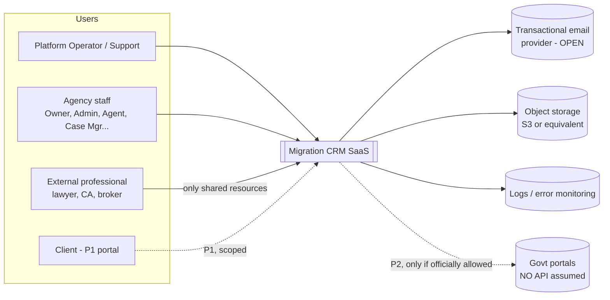

## 4. Container / component architecture

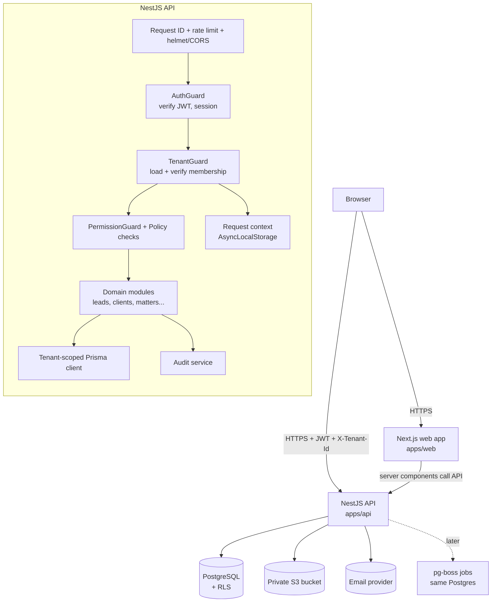

**Why the frontend calls the API directly (not through Next.js only):** keeps one security boundary (the API). Next.js server components may also call the API with the user's token. Business logic never lives in Next.js.

---

## 5. Repository structure (monorepo)

```
migration-crm/
├─ apps/
│  ├─ api/                 # NestJS
│  └─ web/                 # Next.js (App Router)
├─ packages/
│  ├─ db/                  # Prisma schema, migrations, seed, RLS SQL
│  ├─ contracts/           # Zod schemas + shared TS types for API DTOs
│  ├─ permissions/         # permission codes, role templates (used by api + web)
│  ├─ config/              # eslint, tsconfig, prettier presets
│  └─ ui/                  # shared shadcn/ui components (optional, later)
├─ docs/
│  ├─ PRODUCT_BRIEF.md
│  ├─ ARCHITECTURE.md      # this document, once approved
│  └─ adr/                 # one file per decision (ADR-0001-monorepo.md ...)
├─ infra/                  # docker-compose (local), IaC later
└─ .github/workflows/      # CI
```

**Monorepo vs separate repos:**
- Monorepo pros: shared types (API contract can't drift), one PR for a full feature, one CI pipeline.
- Separate repos pros: independent release and access control — not needed for one small team.
- **Recommendation: monorepo.** Revisit only if separate teams own web and API.

**Validation strategy (one choice, used everywhere):** [PROPOSED] **Zod** in `packages/contracts`, used by React Hook Form on the web and by a NestJS Zod validation pipe on the API. This replaces class-validator so rules are written once. (Alternative: class-validator on API + Zod on web = duplicate rules.)

---

## 6. Backend module structure (NestJS)

```
apps/api/src/
├─ main.ts
├─ app.module.ts
├─ common/
│  ├─ context/          # RequestContext (AsyncLocalStorage): userId, tenantId, membershipId, permissions
│  ├─ guards/           # AuthGuard, TenantGuard, PermissionGuard, PlatformGuard
│  ├─ decorators/       # @RequirePermission('matter:update'), @CurrentContext(), @Public()
│  ├─ errors/           # RFC 9457 problem+json filter
│  ├─ pagination/       # cursor helpers
│  ├─ idempotency/      # Idempotency-Key interceptor
│  └─ logging/          # pino structured logs, request id, PII redaction
├─ infra/
│  ├─ prisma/           # PrismaService + tenant-scoped client extension
│  ├─ storage/          # S3 adapter (interface so provider can change)
│  ├─ mail/             # email adapter (provider OPEN)
│  └─ jobs/             # pg-boss (later)
├─ modules/
│  ├─ auth/             # register, verify email, login, refresh, logout, password reset
│  ├─ users/            # profile of the global user
│  ├─ tenants/          # workspace create/profile/settings, switch list
│  ├─ memberships/      # list, change role, suspend, remove, owner transfer
│  ├─ invitations/      # create, resend, revoke, accept
│  ├─ roles/            # roles + permissions (system roles in MVP)
│  ├─ branches/
│  ├─ professionals/    # ProfessionalProfile, credentials
│  ├─ partners/         # PartnerOrganization, PartnerContact
│  ├─ leads/
│  ├─ clients/
│  ├─ matters/          # matters, types, stages, assignments, participants, deadlines, history
│  ├─ documents/        # metadata, versions, upload/download URLs
│  ├─ tasks/
│  ├─ appointments/
│  ├─ activities/       # timeline
│  ├─ sharing/          # ResourceShare (external access)
│  ├─ audit/
│  ├─ health/
│  └─ platform/         # platform admin (tenants list, suspend) — separate guard
└─ test/                # integration + cross-tenant suites
```

**Module rules:**
- Each module = controller → service → repository. Controllers have no business logic.
- Modules talk to each other only via exported services (no reaching into another module's tables).
- **Only `infra/prisma` may create a raw Prisma client.** An ESLint rule blocks raw client imports in modules. Modules get the tenant-scoped client.
- `platform/` uses `PlatformGuard` and never reuses tenant guards — keeps the two worlds apart.

## 7. Frontend structure (Next.js App Router)

```
apps/web/src/
├─ app/
│  ├─ (public)/            # login, register, verify-email, forgot/reset password, accept-invite/[token]
│  ├─ (account)/           # /workspaces (choose or create), /account (profile, sessions)
│  ├─ w/[tenantSlug]/      # agency workspace — everything tenant-scoped lives here
│  │  ├─ dashboard/
│  │  ├─ leads/  clients/  matters/  calendar/  tasks/  documents/
│  │  ├─ professionals/  partners/  reports/
│  │  ├─ team/  branches/  settings/
│  │  └─ layout.tsx        # resolves tenant, loads my permissions, sets X-Tenant-Id
│  ├─ shared/              # external collaborator view — only shared matters (P1 UI)
│  └─ platform/            # platform admin (separate layout + guard)
├─ features/               # per-domain hooks, forms, tables (leads/, clients/, ...)
├─ lib/api/                # typed API client (from packages/contracts), TanStack Query keys
├─ lib/auth/               # token in memory, silent refresh
├─ components/             # app shell, states (Empty, Loading, Error, Forbidden, NoResults)
└─ middleware.ts           # redirect unauthenticated users (UX only — NOT security)
```

- Tenant in URL (`/w/acme/...`) lets a user keep **Agency A in one tab and Agency B in another**.
- UI hides buttons the user lacks permission for (UX), but **the API is the only real check**.
- TanStack Query keys always include `tenantId`, so switching tenants never shows cached data from the other tenant.

---

## 8. Multi-tenant isolation strategy

### 8.1 The four layers

| Layer | What it does | Stops |
|---|---|---|
| 1. AuthGuard | Valid JWT + session not revoked | Anonymous access |
| 2. TenantGuard | Reads `X-Tenant-Id` (selector). Loads `Membership(userId, tenantId)`. Requires `status=ACTIVE` and tenant `status=ACTIVE`. Puts `tenantId`, `membershipId`, `kind`, `permissions`, `branchIds` in RequestContext. | Using a tenant you don't belong to; removed/suspended members |
| 3. Scoped data access | Prisma client extension auto-adds `where: { tenantId }` to reads/updates/deletes and sets `tenantId` on creates. Lookups by ID use `findFirst({ where: { id, tenantId } })` → **404 if not found** (never 403, so IDs are not confirmed). | IDOR/BOLA, forgotten filters |
| 4. Postgres RLS | Each transaction runs `SET LOCAL app.tenant_id = '<uuid>'`. RLS policy: `tenant_id = current_setting('app.tenant_id')::uuid`. App connects as a non-owner role without `BYPASSRLS`. | A bug in layer 3, raw SQL mistakes |

Plus **composite FKs** (D4) so cross-tenant links are impossible at DB level.

### 8.2 Request flow

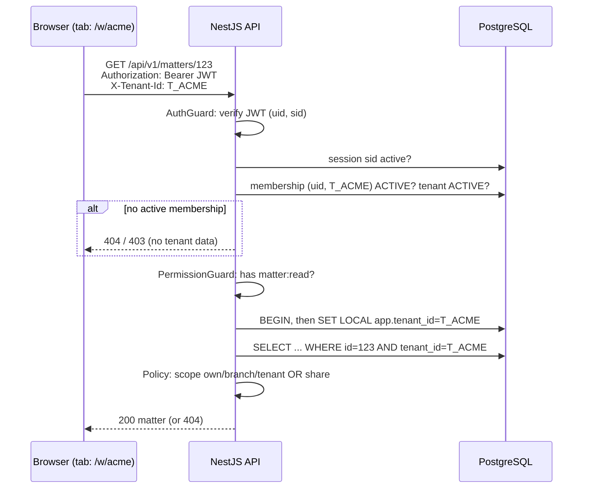

Membership + permissions may be cached for ≤60 s **and** cache is cleared immediately when a membership/role changes. [PROPOSED]

### 8.3 Non-HTTP paths (must also carry tenant)
- **Jobs:** every job payload contains `tenantId` + `actorMembershipId`; the worker re-verifies and sets the same context before touching data.
- **Exports, notifications, scheduled tasks:** same rule. No "run for all tenants" query without an explicit, audited platform context.
- **Search:** always tenant-filtered at query level (Postgres full-text in MVP; no external search engine yet).
- **Files:** object key prefixed by tenant, but access is decided only by the API (§12).

### 8.4 Known RLS trade-offs (honest view)
- Needs every query inside a transaction that sets `app.tenant_id`. With Prisma this means an interactive transaction or a client extension per request — **small performance cost** and **connection-pooler caveats** (PgBouncer transaction mode is OK with `SET LOCAL`; session mode settings are not).
- Migrations run as owner role (bypasses RLS) — fine, but must be a separate DB user.
- **Recommendation:** build layers 1–3 in Stage 2, add RLS on core tables in Stage 2 as well, behind tests. If RLS causes real problems in the Stage 2 spike, we keep layers 1–3 + composite FKs and record the decision in an ADR. [PROPOSED]

---

## 9. Identity, sessions, invitations

### 9.1 Registration + tenant creation

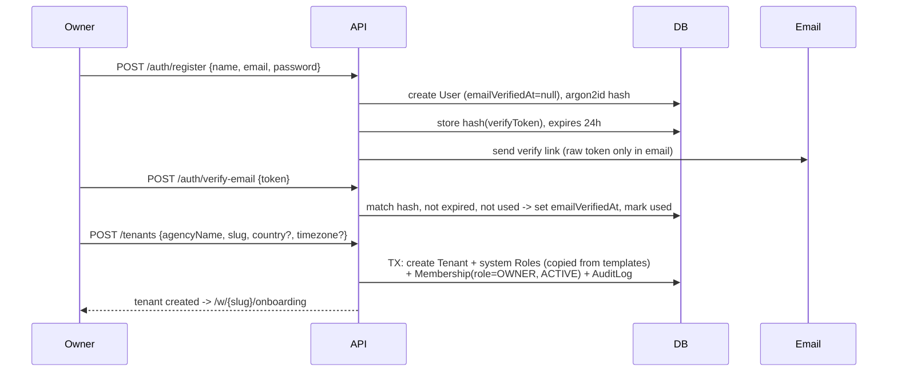

- Tenant is created **after** email verification, as a separate step. This lets a verified user who was only invited never create a tenant by accident. [PROPOSED]
- Registration response is the same whether the email exists or not (no account enumeration).
- Never creates platform roles. Platform admins are created only by a CLI/seed script run by an operator.

### 9.2 Invitation lifecycle

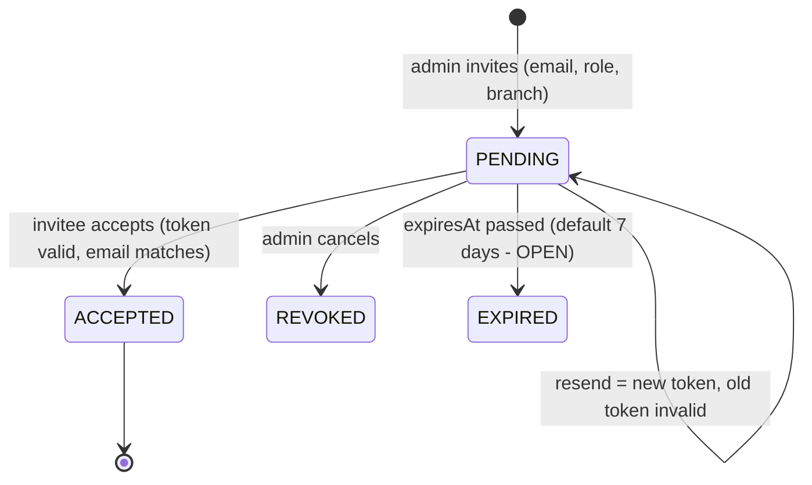

Rules:
- Token = 32 random bytes, sent once by email, **stored as SHA-256 hash**. Single-use, expiring, revocable.
- On accept, the logged-in user's **verified email must equal the invited email** (case-insensitive). If no account exists, the invite page lets them register; email is pre-verified only by completing the invite with that token. [PROPOSED]
- Only one PENDING invite per (tenant, email) — DB partial unique index.
- Inviter cannot grant a role with more permissions than they have (no privilege escalation).

### 9.3 Login and workspace switching

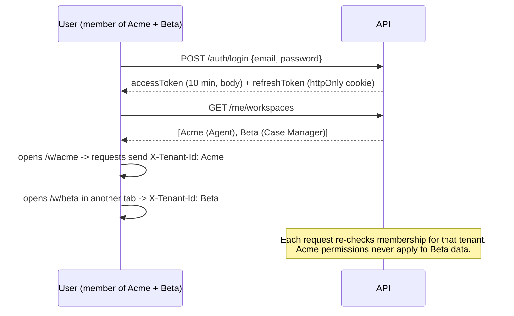

- Access token holds only `sub` (userId), `sid` (session id), `exp`. **No tenant or role in the token** → role changes take effect immediately, no stale tokens.
- Refresh token rotates on every use. Reusing an old one = theft signal → revoke the whole session family.
- Refresh cookie: `HttpOnly; Secure; SameSite=Strict; Path=/api/v1/auth/refresh`. Refresh endpoint also requires a custom header (CSRF defence).
- Password reset: hashed single-use token (≈30 min), revokes all sessions on success.
- Rate limits on login, register, reset, invite accept. Account lockout/backoff after repeated failures.
- **MFA (TOTP)** [CONFIRMED DEC-06]: required for Owner/Admin/platform roles, optional for others. Login = password → TOTP step → tokens. A user with an Owner/Admin membership but no MFA is forced to set it up before using that workspace. Recovery codes hashed; MFA reset by another owner is audited.

### 9.4 Membership rules
- Statuses: `ACTIVE`, `SUSPENDED`, `REMOVED`.
- Remove = status REMOVED + revoke cache. User account and other memberships stay.
- **Last-owner protection:** cannot remove/demote/suspend the last ACTIVE OWNER (checked in a transaction with row lock).
- **Owner transfer:** current owner promotes another member to OWNER; then may step down. Both audited.

### 9.5 How a user in two agencies is handled safely
1. One `User` row, two `Membership` rows: (User, Acme, Agent) and (User, Beta, Case Manager).
2. Every request names one tenant; the API loads **only that membership**. Permissions are never merged across tenants.
3. All data queries are filtered by that one tenant (layer 3) and by RLS (layer 4).
4. Frontend caches are keyed by tenant; switching never shows the other tenant's data.
5. Notifications and emails include the tenant name so the user knows which agency they relate to.
6. If Beta removes them, Beta access stops on the next request; Acme access is unaffected.

---

## 10. RBAC and resource-level authorization

### 10.1 Model
- **Permission** = code string `resource:action` (e.g. `matter:read`, `matter:update`, `document:download`). Defined in code (`packages/permissions`), not editable by tenants.
- **Scope** per grant: `own` (assigned to me / created by me), `branch` (my branches), `tenant` (everything in tenant).
- **Role** = tenant-owned bundle of (permission, scope). On tenant creation, **system roles are copied from templates**. Custom roles = P1 [PROPOSED].
- **Policy check** (in services, not only guards):
  `can(ctx, 'matter:update', matter)` → true if (a) role grants it with a scope that covers this matter, or (b) an active `ResourceShare` grants it for this exact resource.
- **Lists** apply the same rule as a query filter (e.g. scope `own` → `WHERE assignments.membershipId = me`).

### 10.2 Draft MVP role matrix [OPEN — needs your confirmation]

| Permission group | Owner | Admin | Branch Mgr | Migration Agent / Lawyer | Case Mgr | Sales/Lead Mgr | Reception | Finance |
|---|---|---|---|---|---|---|---|---|
| Tenant settings, billing | ✓ | settings only | – | – | – | – | – | billing view |
| Team, invites, roles | ✓ | ✓ (not owner) | own branch | – | – | – | – | – |
| Leads | tenant | tenant | branch | own | own | tenant | create + read | – |
| Clients | tenant | tenant | branch | own | own | read basic | read basic | read basic |
| Matters | tenant | tenant | branch | own | own | – | – | read basic |
| Documents (download) | tenant | tenant | branch | own matters | own matters | – | upload only | – |
| Professionals / Partners | ✓ | ✓ | read | read | read | read + edit partners | read | read |
| Audit log | ✓ | ✓ | – | – | – | – | – | – |

"own" = assigned to the matter/lead. This is a starting point only.

Brief roles like **CA/Accountant, Broker/Referral Partner, Education Consultant, External Legal Consultant, Employer/Sponsor Contact** — I propose these are **EXTERNAL memberships** (access only via shares) unless you tell me some are employees. [OPEN]

### 10.3 Platform roles
- Separate table `PlatformRoleAssignment` (SUPER_ADMIN, SUPPORT, BILLING_ADMIN). Separate guard and routes (`/api/v1/platform/*`).
- Platform roles see **tenant metadata** (name, status, plan, counts), **not** clients/matters/documents.
- Support access to tenant data = P1 "break-glass": tenant owner approves a time-bound `SupportAccessGrant`, every action audited. [PROPOSED]

---

## 11. External sharing — partner sees one matter only

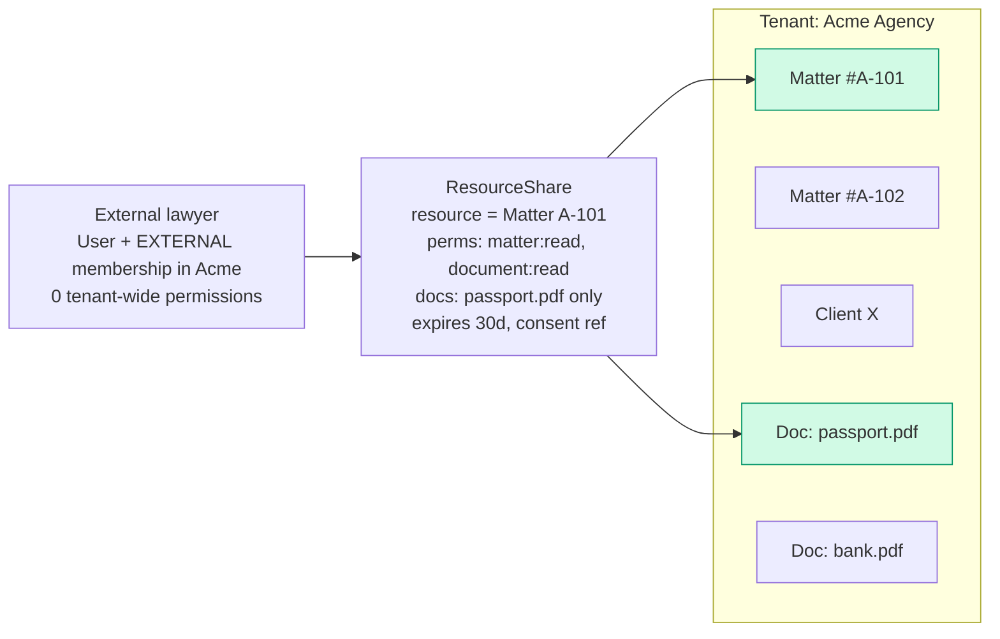

How it works:
1. Acme admin (with `share:create`) selects matter A-101, the lawyer's professional profile, the permissions, which documents, expiry, and the consent record (if required). [OPEN: is consent mandatory?]
2. If the lawyer has no login, an invitation of kind EXTERNAL is sent. Accepting creates an **EXTERNAL membership** with **no role permissions**.
3. On any request, the policy sees `kind=EXTERNAL` → **only** resources with an active, unexpired, unrevoked `ResourceShare` are visible. Lists return only shared items. Everything else → 404.
4. The lawyer's own firm or other agencies are separate tenants; this share never reveals anything in them, and their data never flows into Acme.
5. Revoke = set `revokedAt`; takes effect on next request. All share create/revoke/access events are audited.

---

## 12. Secure document storage

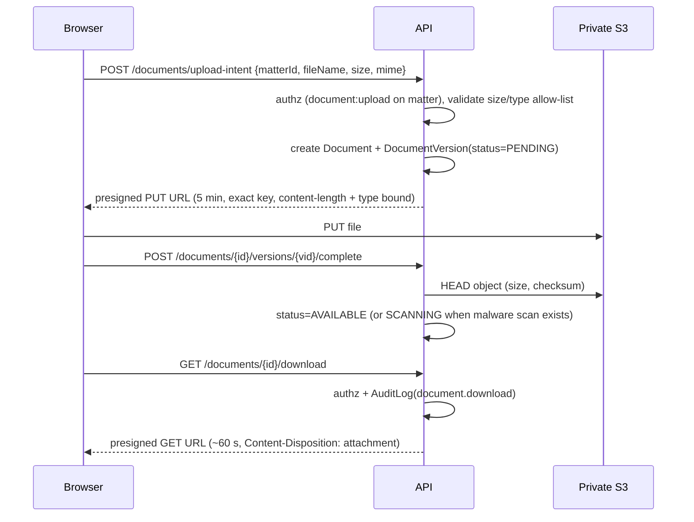

- Bucket: Block Public Access ON, SSE-KMS, versioning ON, TLS-only bucket policy, CORS limited to our web origin.
- Key: `tenants/{tenantId}/docs/{documentId}/{versionId}` — random IDs, **not** user file names (stored as metadata only).
- Validate type by magic bytes after upload, not only by extension/MIME header.
- Malware scanning: designed as status `SCANNING`; tool choice [OPEN] (e.g. a managed S3 malware-scan service or ClamAV worker — verify options/cost at that stage).
- Documents are never shown in dashboard previews or put in notification text.

---

## 13. Data model

### 13.1 ERD — identity and tenancy

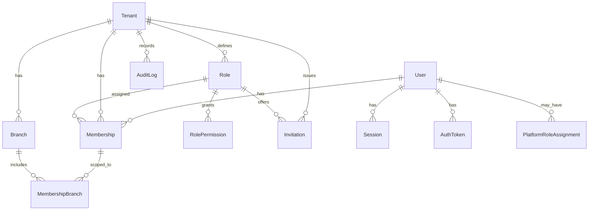

### 13.2 ERD — directory, CRM, matters

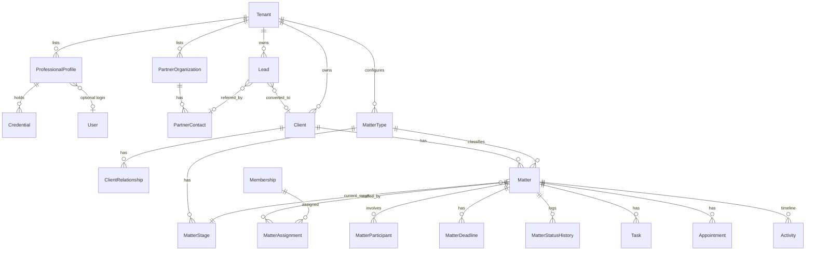

### 13.3 ERD — documents and sharing

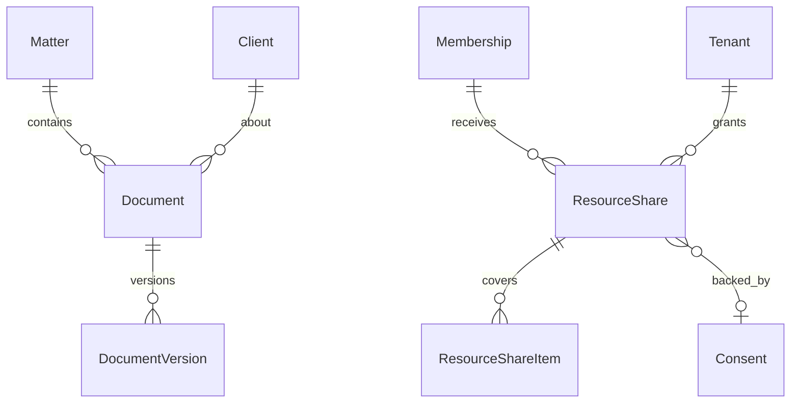

### 13.4 Draft Prisma schema (P0 scope)

> **Not validated yet** — I did not install Prisma (per your rule). Validate with `prisma validate` in Stage 1. Composite FKs reusing `tenantId` in several relations need a short spike (Prisma allows it; referential actions must be `Restrict`/`NoAction` on those, because `SetNull` would try to null `tenantId`).
> Conventions: table names snake_case via `@@map`; every tenant-owned model has `tenantId`, `@@unique([tenantId, id])`, and an index starting with `tenantId`.

```prisma
generator client {
  provider = "prisma-client-js"
}

datasource db {
  provider = "postgresql"
  url      = env("DATABASE_URL")
}

// ───────────── Enums (lifecycle only; business categories are tables) ─────────────

enum TenantStatus     { ACTIVE SUSPENDED PENDING_DELETION }
enum MembershipKind   { STAFF EXTERNAL }
enum MembershipStatus { ACTIVE SUSPENDED REMOVED }
enum InvitationStatus { PENDING ACCEPTED REVOKED EXPIRED }
enum AuthTokenType    { EMAIL_VERIFY PASSWORD_RESET }
enum PermissionScope  { OWN BRANCH TENANT }
enum PlatformRole     { SUPER_ADMIN SUPPORT BILLING_ADMIN }
enum VerificationStatus { UNVERIFIED PENDING VERIFIED REJECTED EXPIRED }
enum ClientKind       { INDIVIDUAL BUSINESS }
enum LeadStatus       { OPEN CONVERTED LOST ARCHIVED }
enum MatterStatus     { OPEN ON_HOLD CLOSED ARCHIVED }
enum TaskStatus       { TODO IN_PROGRESS DONE CANCELLED }
enum Priority         { LOW MEDIUM HIGH URGENT }
enum DocVersionStatus { PENDING SCANNING AVAILABLE REJECTED }
enum ShareResourceType { MATTER DOCUMENT CLIENT }

// ───────────── Global identity ─────────────

model User {
  id              String    @id @default(uuid()) @db.Uuid
  email           String    @unique            // store lower-cased; consider citext
  name            String
  passwordHash    String?
  emailVerifiedAt DateTime?
  mfaSecretEnc    String?                       // encrypted; MFA built later
  createdAt       DateTime  @default(now())
  updatedAt       DateTime  @updatedAt
  disabledAt      DateTime?

  memberships     Membership[]
  sessions        Session[]
  authTokens      AuthToken[]
  platformRoles   PlatformRoleAssignment[]
  professionalProfiles ProfessionalProfile[]

  @@map("users")
}

model Session {
  id               String    @id @default(uuid()) @db.Uuid
  userId           String    @db.Uuid
  refreshTokenHash String    @unique
  familyId         String    @db.Uuid           // rotation family for reuse detection
  userAgent        String?
  ipAddress        String?
  expiresAt        DateTime
  revokedAt        DateTime?
  createdAt        DateTime  @default(now())
  lastUsedAt       DateTime?
  user             User      @relation(fields: [userId], references: [id], onDelete: Cascade)

  @@index([userId])
  @@index([familyId])
  @@map("sessions")
}

model AuthToken {
  id        String        @id @default(uuid()) @db.Uuid
  userId    String        @db.Uuid
  type      AuthTokenType
  tokenHash String        @unique
  expiresAt DateTime
  usedAt    DateTime?
  createdAt DateTime      @default(now())
  user      User          @relation(fields: [userId], references: [id], onDelete: Cascade)

  @@index([userId, type])
  @@map("auth_tokens")
}

model PlatformRoleAssignment {
  id        String       @id @default(uuid()) @db.Uuid
  userId    String       @db.Uuid
  role      PlatformRole
  grantedBy String?      @db.Uuid
  createdAt DateTime     @default(now())
  revokedAt DateTime?
  user      User         @relation(fields: [userId], references: [id])

  @@unique([userId, role])
  @@map("platform_role_assignments")
}

// ───────────── Tenancy & access ─────────────

model Tenant {
  id        String       @id @default(uuid()) @db.Uuid
  slug      String       @unique
  name      String
  status    TenantStatus @default(ACTIVE)
  country   String?      // ISO 3166-1; launch countries OPEN
  timezone  String?      // IANA
  locale    String?
  createdAt DateTime     @default(now())
  updatedAt DateTime     @updatedAt

  branches    Branch[]
  roles       Role[]
  memberships Membership[]
  invitations Invitation[]
  auditLogs   AuditLog[]

  @@map("tenants")
}

model Branch {
  id        String    @id @default(uuid()) @db.Uuid
  tenantId  String    @db.Uuid
  name      String
  address   Json?
  timezone  String?
  createdAt DateTime  @default(now())
  updatedAt DateTime  @updatedAt
  deletedAt DateTime?
  tenant    Tenant    @relation(fields: [tenantId], references: [id])
  members   MembershipBranch[]

  @@unique([tenantId, id])
  @@unique([tenantId, name])
  @@map("branches")
}

model Role {
  id          String   @id @default(uuid()) @db.Uuid
  tenantId    String   @db.Uuid
  key         String   // e.g. "owner", "migration_agent"
  name        String
  isSystem    Boolean  @default(true)
  createdAt   DateTime @default(now())
  updatedAt   DateTime @updatedAt
  tenant      Tenant   @relation(fields: [tenantId], references: [id])
  permissions RolePermission[]
  memberships Membership[]
  invitations Invitation[]

  @@unique([tenantId, id])
  @@unique([tenantId, key])
  @@map("roles")
}

model RolePermission {
  id         String          @id @default(uuid()) @db.Uuid
  tenantId   String          @db.Uuid
  roleId     String          @db.Uuid
  permission String          // code from packages/permissions, e.g. "matter:update"
  scope      PermissionScope @default(TENANT)
  role       Role            @relation(fields: [tenantId, roleId], references: [tenantId, id], onDelete: Cascade)

  @@unique([roleId, permission])
  @@map("role_permissions")
}

model Membership {
  id         String           @id @default(uuid()) @db.Uuid
  tenantId   String           @db.Uuid
  userId     String           @db.Uuid
  roleId     String?          @db.Uuid         // null for EXTERNAL (access only via shares)
  kind       MembershipKind   @default(STAFF)
  status     MembershipStatus @default(ACTIVE)
  joinedAt   DateTime         @default(now())
  removedAt  DateTime?
  updatedAt  DateTime         @updatedAt
  tenant     Tenant           @relation(fields: [tenantId], references: [id])
  user       User             @relation(fields: [userId], references: [id])
  role       Role?            @relation(fields: [tenantId, roleId], references: [tenantId, id], onDelete: Restrict)
  branches   MembershipBranch[]
  assignments MatterAssignment[]
  sharesReceived ResourceShare[] @relation("ShareGrantee")

  @@unique([tenantId, id])
  @@unique([tenantId, userId])                  // one membership per user per tenant
  @@index([userId])
  @@map("memberships")
}

model MembershipBranch {
  tenantId     String     @db.Uuid
  membershipId String     @db.Uuid
  branchId     String     @db.Uuid
  membership   Membership @relation(fields: [tenantId, membershipId], references: [tenantId, id], onDelete: Cascade)
  branch       Branch     @relation(fields: [tenantId, branchId], references: [tenantId, id], onDelete: Cascade)

  @@id([membershipId, branchId])
  @@map("membership_branches")
}

model Invitation {
  id          String           @id @default(uuid()) @db.Uuid
  tenantId    String           @db.Uuid
  email       String
  kind        MembershipKind   @default(STAFF)
  roleId      String?          @db.Uuid
  branchIds   String[]         @db.Uuid
  tokenHash   String           @unique
  status      InvitationStatus @default(PENDING)
  expiresAt   DateTime
  invitedById String           @db.Uuid         // membershipId of inviter
  acceptedByUserId String?     @db.Uuid
  acceptedAt  DateTime?
  revokedAt   DateTime?
  createdAt   DateTime         @default(now())
  tenant      Tenant           @relation(fields: [tenantId], references: [id])
  role        Role?            @relation(fields: [tenantId, roleId], references: [tenantId, id], onDelete: Restrict)

  @@index([tenantId, email])
  // Raw SQL migration: UNIQUE (tenant_id, lower(email)) WHERE status = 'PENDING'
  @@map("invitations")
}

// ───────────── Directory ─────────────

model ProfessionalProfile {
  id                 String   @id @default(uuid()) @db.Uuid
  tenantId           String   @db.Uuid
  userId             String?  @db.Uuid           // optional login link
  fullName           String
  professionTypeKey  String                       // reference data, configurable
  email              String?
  phone              String?
  organizationName   String?
  partnerOrgId       String?  @db.Uuid
  notes              String?
  createdAt          DateTime @default(now())
  updatedAt          DateTime @updatedAt
  deletedAt          DateTime?
  user               User?    @relation(fields: [userId], references: [id])
  partnerOrg         PartnerOrganization? @relation(fields: [tenantId, partnerOrgId], references: [tenantId, id], onDelete: Restrict)
  credentials        Credential[]

  @@unique([tenantId, id])
  @@index([tenantId, professionTypeKey])
  @@map("professional_profiles")
}

model Credential {
  id            String             @id @default(uuid()) @db.Uuid
  tenantId      String             @db.Uuid
  profileId     String             @db.Uuid
  credentialType String
  issuer        String
  identifier    String
  issuedAt      DateTime?
  expiresAt     DateTime?
  status        VerificationStatus @default(UNVERIFIED)
  verifiedAt    DateTime?
  verifiedById  String?            @db.Uuid
  evidenceDocId String?            @db.Uuid
  profile       ProfessionalProfile @relation(fields: [tenantId, profileId], references: [tenantId, id], onDelete: Cascade)

  @@index([tenantId, profileId])
  @@map("credentials")
}

model PartnerOrganization {
  id        String   @id @default(uuid()) @db.Uuid
  tenantId  String   @db.Uuid
  name      String
  typeKey   String                    // referral agency, law firm, employer ... (configurable)
  website   String?
  email     String?
  phone     String?
  createdAt DateTime @default(now())
  updatedAt DateTime @updatedAt
  deletedAt DateTime?
  contacts      PartnerContact[]
  professionals ProfessionalProfile[]

  @@unique([tenantId, id])
  @@index([tenantId, name])
  @@map("partner_organizations")
}

model PartnerContact {
  id           String   @id @default(uuid()) @db.Uuid
  tenantId     String   @db.Uuid
  partnerOrgId String   @db.Uuid
  fullName     String
  email        String?
  phone        String?
  position     String?
  createdAt    DateTime @default(now())
  updatedAt    DateTime @updatedAt
  deletedAt    DateTime?
  partnerOrg   PartnerOrganization @relation(fields: [tenantId, partnerOrgId], references: [tenantId, id], onDelete: Restrict)
  leads        Lead[]

  @@unique([tenantId, id])
  @@map("partner_contacts")
}

// ───────────── CRM ─────────────

model Lead {
  id               String     @id @default(uuid()) @db.Uuid
  tenantId         String     @db.Uuid
  branchId         String?    @db.Uuid
  ownerMembershipId String?   @db.Uuid
  fullName         String
  email            String?
  phone            String?
  sourceKey        String?                     // configurable source list
  referredByContactId String? @db.Uuid
  interest         String?
  pipelineStageKey String?                     // configurable pipeline (Stage 4)
  status           LeadStatus @default(OPEN)
  convertedClientId String?   @db.Uuid
  convertedAt      DateTime?
  createdById      String     @db.Uuid
  createdAt        DateTime   @default(now())
  updatedAt        DateTime   @updatedAt
  deletedAt        DateTime?
  referredBy       PartnerContact? @relation(fields: [tenantId, referredByContactId], references: [tenantId, id], onDelete: Restrict)
  convertedClient  Client?    @relation(fields: [tenantId, convertedClientId], references: [tenantId, id], onDelete: Restrict)

  @@unique([tenantId, id])
  @@index([tenantId, status, createdAt])
  @@index([tenantId, email])
  @@index([tenantId, phone])
  @@map("leads")
}

model Client {
  id          String     @id @default(uuid()) @db.Uuid
  tenantId    String     @db.Uuid
  branchId    String?    @db.Uuid
  kind        ClientKind
  displayName String
  givenName   String?
  familyName  String?
  businessName String?
  email       String?
  phone       String?
  dateOfBirth DateTime?  @db.Date               // sensitive: consider field-level encryption
  nationality String?
  clientNumber String                            // human-friendly, unique per tenant
  createdById String     @db.Uuid
  createdAt   DateTime   @default(now())
  updatedAt   DateTime   @updatedAt
  deletedAt   DateTime?
  matters     Matter[]
  leads       Lead[]
  relationships ClientRelationship[] @relation("FromClient")
  relatedTo     ClientRelationship[] @relation("ToClient")
  documents   Document[]

  @@unique([tenantId, id])
  @@unique([tenantId, clientNumber])
  @@index([tenantId, email])
  @@index([tenantId, displayName])
  @@map("clients")
}

model ClientRelationship {
  id           String @id @default(uuid()) @db.Uuid
  tenantId     String @db.Uuid
  fromClientId String @db.Uuid
  toClientId   String @db.Uuid
  relationType String              // spouse, child, director ... (configurable)
  fromClient   Client @relation("FromClient", fields: [tenantId, fromClientId], references: [tenantId, id], onDelete: Cascade)
  toClient     Client @relation("ToClient",   fields: [tenantId, toClientId],   references: [tenantId, id], onDelete: Cascade)

  @@unique([fromClientId, toClientId, relationType])
  @@map("client_relationships")
}

// ───────────── Matters ─────────────

model MatterType {
  id        String   @id @default(uuid()) @db.Uuid
  tenantId  String   @db.Uuid
  key       String
  name      String
  isActive  Boolean  @default(true)
  version   Int      @default(1)            // versioned templates later
  stages    MatterStage[]
  matters   Matter[]

  @@unique([tenantId, id])
  @@unique([tenantId, key, version])
  @@map("matter_types")
}

model MatterStage {
  id           String     @id @default(uuid()) @db.Uuid
  tenantId     String     @db.Uuid
  matterTypeId String     @db.Uuid
  key          String
  name         String
  sortOrder    Int
  isTerminal   Boolean    @default(false)
  matterType   MatterType @relation(fields: [tenantId, matterTypeId], references: [tenantId, id], onDelete: Cascade)
  matters      Matter[]

  @@unique([tenantId, id])
  @@unique([matterTypeId, key])
  @@map("matter_stages")
}

model Matter {
  id           String       @id @default(uuid()) @db.Uuid
  tenantId     String       @db.Uuid
  branchId     String?      @db.Uuid
  clientId     String       @db.Uuid
  matterTypeId String       @db.Uuid
  stageId      String?      @db.Uuid
  reference    String                         // unique per tenant, e.g. A-2026-0001
  title        String
  status       MatterStatus @default(OPEN)
  openedAt     DateTime     @default(now())
  closedAt     DateTime?
  createdById  String       @db.Uuid
  createdAt    DateTime     @default(now())
  updatedAt    DateTime     @updatedAt
  deletedAt    DateTime?
  client       Client       @relation(fields: [tenantId, clientId], references: [tenantId, id], onDelete: Restrict)
  matterType   MatterType   @relation(fields: [tenantId, matterTypeId], references: [tenantId, id], onDelete: Restrict)
  stage        MatterStage? @relation(fields: [tenantId, stageId], references: [tenantId, id], onDelete: Restrict)
  assignments  MatterAssignment[]
  participants MatterParticipant[]
  deadlines    MatterDeadline[]
  history      MatterStatusHistory[]
  documents    Document[]
  tasks        Task[]
  appointments Appointment[]

  @@unique([tenantId, id])
  @@unique([tenantId, reference])
  @@index([tenantId, status, updatedAt])
  @@index([tenantId, clientId])
  @@map("matters")
}

model MatterAssignment {
  id           String     @id @default(uuid()) @db.Uuid
  tenantId     String     @db.Uuid
  matterId     String     @db.Uuid
  membershipId String     @db.Uuid
  responsibility String                       // lead_agent, case_manager ... (configurable)
  assignedAt   DateTime   @default(now())
  unassignedAt DateTime?
  matter       Matter     @relation(fields: [tenantId, matterId], references: [tenantId, id], onDelete: Cascade)
  membership   Membership @relation(fields: [tenantId, membershipId], references: [tenantId, id], onDelete: Restrict)

  @@index([tenantId, membershipId])
  @@index([matterId])
  @@map("matter_assignments")
}

model MatterParticipant {
  id             String  @id @default(uuid()) @db.Uuid
  tenantId       String  @db.Uuid
  matterId       String  @db.Uuid
  roleKey        String                      // sponsor, dependant, external_lawyer ...
  clientId       String? @db.Uuid            // exactly one of these three is set (CHECK constraint)
  professionalId String? @db.Uuid
  partnerOrgId   String? @db.Uuid
  matter         Matter  @relation(fields: [tenantId, matterId], references: [tenantId, id], onDelete: Cascade)

  @@index([matterId])
  @@map("matter_participants")
}

model MatterDeadline {
  id          String    @id @default(uuid()) @db.Uuid
  tenantId    String    @db.Uuid
  matterId    String    @db.Uuid
  title       String
  dueAt       DateTime
  remindAt    DateTime[]
  completedAt DateTime?
  matter      Matter    @relation(fields: [tenantId, matterId], references: [tenantId, id], onDelete: Cascade)

  @@index([tenantId, dueAt])
  @@map("matter_deadlines")
}

model MatterStatusHistory {
  id          String        @id @default(uuid()) @db.Uuid
  tenantId    String        @db.Uuid
  matterId    String        @db.Uuid
  fromStatus  MatterStatus?
  toStatus    MatterStatus?
  fromStageId String?       @db.Uuid
  toStageId   String?       @db.Uuid
  changedById String        @db.Uuid
  reason      String?
  createdAt   DateTime      @default(now())
  matter      Matter        @relation(fields: [tenantId, matterId], references: [tenantId, id], onDelete: Cascade)

  @@index([matterId, createdAt])
  @@map("matter_status_history")
}

// ───────────── Operations ─────────────

model Task {
  id            String     @id @default(uuid()) @db.Uuid
  tenantId      String     @db.Uuid
  title         String
  description   String?
  assigneeId    String?    @db.Uuid           // membershipId
  dueAt         DateTime?
  priority      Priority   @default(MEDIUM)
  status        TaskStatus @default(TODO)
  matterId      String?    @db.Uuid
  relatedType   String?                       // lead | client (polymorphic, validated in app)
  relatedId     String?    @db.Uuid
  createdById   String     @db.Uuid
  createdAt     DateTime   @default(now())
  updatedAt     DateTime   @updatedAt
  deletedAt     DateTime?
  matter        Matter?    @relation(fields: [tenantId, matterId], references: [tenantId, id], onDelete: Restrict)

  @@index([tenantId, assigneeId, status, dueAt])
  @@map("tasks")
}

model Appointment {
  id          String    @id @default(uuid()) @db.Uuid
  tenantId    String    @db.Uuid
  title       String
  startsAt    DateTime
  endsAt      DateTime
  location    String?
  hostId      String    @db.Uuid              // membershipId
  matterId    String?   @db.Uuid
  leadId      String?   @db.Uuid
  clientId    String?   @db.Uuid
  createdAt   DateTime  @default(now())
  updatedAt   DateTime  @updatedAt
  cancelledAt DateTime?
  matter      Matter?   @relation(fields: [tenantId, matterId], references: [tenantId, id], onDelete: Restrict)

  @@index([tenantId, hostId, startsAt])
  @@map("appointments")
}

model Activity {
  id          String   @id @default(uuid()) @db.Uuid
  tenantId    String   @db.Uuid
  type        String                          // note, call, email, meeting, system
  subjectType String                          // lead | client | matter
  subjectId   String   @db.Uuid
  actorId     String?  @db.Uuid
  body        String?                         // keep minimal; sensitive
  metadata    Json?
  createdAt   DateTime @default(now())

  @@index([tenantId, subjectType, subjectId, createdAt])
  @@map("activities")
}

// ───────────── Documents & sharing ─────────────

model Document {
  id             String   @id @default(uuid()) @db.Uuid
  tenantId       String   @db.Uuid
  matterId       String?  @db.Uuid
  clientId       String?  @db.Uuid
  title          String
  categoryKey    String?                       // configurable
  classification String   @default("CONFIDENTIAL")
  currentVersionId String? @db.Uuid
  uploadedById   String   @db.Uuid
  createdAt      DateTime @default(now())
  updatedAt      DateTime @updatedAt
  deletedAt      DateTime?
  matter         Matter?  @relation(fields: [tenantId, matterId], references: [tenantId, id], onDelete: Restrict)
  client         Client?  @relation(fields: [tenantId, clientId], references: [tenantId, id], onDelete: Restrict)
  versions       DocumentVersion[]

  @@unique([tenantId, id])
  @@index([tenantId, matterId])
  @@map("documents")
}

model DocumentVersion {
  id           String           @id @default(uuid()) @db.Uuid
  tenantId     String           @db.Uuid
  documentId   String           @db.Uuid
  versionNo    Int
  storageKey   String           @unique
  originalName String
  mimeType     String
  sizeBytes    BigInt
  sha256       String?
  status       DocVersionStatus @default(PENDING)
  uploadedById String           @db.Uuid
  createdAt    DateTime         @default(now())
  document     Document         @relation(fields: [tenantId, documentId], references: [tenantId, id], onDelete: Restrict)

  @@unique([documentId, versionNo])
  @@map("document_versions")
}

model ResourceShare {
  id                 String            @id @default(uuid()) @db.Uuid
  tenantId           String            @db.Uuid
  granteeMembershipId String           @db.Uuid    // EXTERNAL membership
  resourceType       ShareResourceType
  resourceId         String            @db.Uuid
  permissions        String[]                       // subset, e.g. ["matter:read","document:read"]
  purpose            String?
  consentId          String?           @db.Uuid     // Consent model in Stage 6
  expiresAt          DateTime?
  revokedAt          DateTime?
  grantedById        String            @db.Uuid
  createdAt          DateTime          @default(now())
  grantee            Membership        @relation("ShareGrantee", fields: [tenantId, granteeMembershipId], references: [tenantId, id], onDelete: Restrict)
  items              ResourceShareItem[]

  @@index([tenantId, granteeMembershipId])
  @@index([tenantId, resourceType, resourceId])
  @@unique([tenantId, id])
  @@map("resource_shares")
}

model ResourceShareItem {                          // e.g. which documents inside a shared matter
  id           String            @id @default(uuid()) @db.Uuid
  tenantId     String            @db.Uuid
  shareId      String            @db.Uuid
  resourceType ShareResourceType
  resourceId   String            @db.Uuid
  share        ResourceShare     @relation(fields: [tenantId, shareId], references: [tenantId, id], onDelete: Cascade)

  @@unique([shareId, resourceType, resourceId])
  @@map("resource_share_items")
}

// ───────────── Audit ─────────────

model AuditLog {
  id           BigInt   @id @default(autoincrement())
  tenantId     String?  @db.Uuid               // null = platform-level event
  actorUserId  String?  @db.Uuid
  actorMembershipId String? @db.Uuid
  action       String                          // "document.download", "membership.role_changed"
  targetType   String?
  targetId     String?
  requestId    String?
  ipAddress    String?
  userAgent    String?
  metadata     Json?                           // never raw sensitive values
  createdAt    DateTime @default(now())
  tenant       Tenant?  @relation(fields: [tenantId], references: [id])

  @@index([tenantId, createdAt])
  @@index([tenantId, targetType, targetId])
  @@map("audit_logs")
}
```

**Deferred models** (designed later, not in first schema): `Consent` (Stage 6), `Referral` (P1), `ChecklistTemplate/ChecklistItem` + `DocumentRequirement` (Stage 5), `Notification` (P1), `Plan/Subscription` (Stage 7), `SupportAccessGrant` (P1), `Integration` (P2).

**DB-level extras via raw SQL migrations:** RLS policies, partial unique indexes (pending invites, lower(email)), CHECK constraints (MatterParticipant exactly-one), audit table append-only (app role has INSERT/SELECT only).

**Lead conversion (avoid duplicate clients):** convert = one transaction: check possible duplicates (same tenant + email/phone/name+DOB) → user picks "create new" or "link existing" → set `lead.convertedClientId`, `status=CONVERTED`, keep `sourceKey`/`referredBy` for attribution. Idempotent with `Idempotency-Key`.

---

## 14. API conventions and representative endpoints

**Conventions [PROPOSED]**
- Base: `/api/v1`. Tenant routes require `X-Tenant-Id`. Platform routes under `/api/v1/platform`.
- Success: resource JSON directly; lists: `{ "data": [...], "nextCursor": "..." | null }`.
- Errors: RFC 9457 `application/problem+json`: `{ type, title, status, detail, code, requestId, errors? }`.
- Pagination: cursor-based, `?limit=` max 100.
- `Idempotency-Key` header on POST that creates records (stored 24 h per tenant+user).
- Not found and not allowed-to-know → **404**. Known resource but missing permission → **403**.

| Module | Endpoint | Notes |
|---|---|---|
| auth | `POST /auth/register` | Same response if email exists |
| auth | `POST /auth/verify-email` | `{ token }` |
| auth | `POST /auth/login` → `{ accessToken }` + refresh cookie | rate-limited |
| auth | `POST /auth/refresh`, `POST /auth/logout` | rotation |
| auth | `POST /auth/password/forgot`, `POST /auth/password/reset` | revokes sessions |
| me | `GET /me`, `GET /me/workspaces`, `GET /me/sessions`, `DELETE /me/sessions/:id` | |
| tenants | `POST /tenants` | verified user only; creates OWNER |
| tenants | `GET /tenant`, `PATCH /tenant` | current tenant from header |
| memberships | `GET /members`, `PATCH /members/:id` (role/branches/status), `DELETE /members/:id` | last-owner protection |
| memberships | `POST /members/:id/transfer-ownership` | owner only |
| invitations | `POST /invitations`, `GET /invitations`, `POST /invitations/:id/resend`, `DELETE /invitations/:id` | |
| invitations | `GET /invitations/preview?token=` , `POST /invitations/accept` `{ token }` | no X-Tenant-Id needed |
| leads | `GET/POST /leads`, `GET/PATCH/DELETE /leads/:id`, `POST /leads/:id/convert` | |
| clients | `GET/POST /clients`, `GET/PATCH /clients/:id`, `GET /clients/duplicates?email=&phone=` | |
| matters | `GET/POST /matters`, `GET/PATCH /matters/:id`, `POST /matters/:id/stage`, `POST /matters/:id/assignments` | history auto-written |
| documents | `POST /documents/upload-intent`, `POST /documents/:id/versions/:vid/complete`, `GET /documents/:id/download` | audited |
| sharing | `POST /shares`, `GET /shares`, `DELETE /shares/:id` | external access |
| platform | `GET /platform/tenants`, `POST /platform/tenants/:id/suspend` | metadata only |

Example — create invitation:
```http
POST /api/v1/invitations
Authorization: Bearer <jwt>
X-Tenant-Id: 6f1c...    Idempotency-Key: 3b2e...
{ "email": "agent@acme.com", "roleKey": "migration_agent", "branchIds": ["..."] }

201 { "id": "...", "email": "agent@acme.com", "status": "PENDING", "expiresAt": "2026-11-17T..." }
403 problem+json { "code": "ROLE_ESCALATION", ... }   // inviter lacks permissions of that role
409 problem+json { "code": "INVITE_ALREADY_PENDING", ... }
```

---

## 15. Testing strategy

| Level | Tool | Focus |
|---|---|---|
| Unit | Jest | Policy `can()`, permission/scope logic, token hashing/expiry, last-owner rule |
| Integration (API + real Postgres) | Jest + Supertest + Docker Postgres (Testcontainers or compose) | Every endpoint, real DB, RLS on |
| **Cross-tenant suite (mandatory)** | Jest, auto-generated | See below |
| E2E | Playwright | Register → create tenant → invite → accept → switch workspace; share matter to external |
| Security | ZAP baseline (later), dependency audit in CI | Headers, common vulns |

**Cross-tenant test design:**
- Fixture: Tenant A + Tenant B, each with owner, agent, external user, sample lead/client/matter/document; plus one user who is a member of **both**.
- A **route registry test** lists every controller route; CI **fails if a tenant route has no cross-tenant test entry**.
- For each route: User of A calls with B's resource ID (with A header) → 404. User of A sends `X-Tenant-Id: B` → 403/404. Removed member → denied. External user → only shared matter visible; other matter → 404; after revoke → 404.
- DB test: open a connection with `app.tenant_id=A`, try `SELECT` from B rows → 0 rows (RLS proof).
- Job test: job payload with tenant A cannot read tenant B.

---

## 16. Deployment, environments, secrets, logging, backups

**Environments:** `local` (docker-compose Postgres + MinIO for S3) → `dev` → `staging` → `prod`. Separate accounts/projects and separate DBs/buckets per env. Prod data never copied to lower envs.

**Minimum viable hosting [PROPOSED, provider OPEN]** — example on AWS (you know AWS):
- API + web as Docker containers on **ECS Fargate** (or App Runner for simpler start) behind an ALB with TLS.
- **RDS PostgreSQL** (Multi-AZ for prod), automated backups + point-in-time recovery.
- **S3** (documents) with versioning; **KMS** keys.
- **Secrets Manager** for DB creds, JWT keys, email API key. Nothing secret in git; `.env.example` only.
- **Region = data residency decision [OPEN]** (e.g. if Australia-first, an Australian region; not assumed).
- Alternative for faster start: Vercel (web) + managed Postgres. Trade-off: data residency and fewer controls.

**CI (GitHub Actions):** install → lint → typecheck → unit → integration (Postgres service) → cross-tenant suite → build → `prisma migrate diff` check. Branch protection, required reviews. Deploy staging on main, prod on manual approval.

**Logging/monitoring:** pino JSON logs with `requestId`, `tenantId`, `userId`; **PII redaction** (no passport numbers, tokens, passwords). Error tracking (e.g. Sentry — OPEN). Health: `/health/live`, `/health/ready` (DB check).

**Backups:** RDS daily snapshots + PITR (retention OPEN), S3 versioning + lifecycle, **restore test before production** and then on a schedule. Runbooks: restore, key rotation, incident response, tenant offboarding.

**Security headers:** Helmet (CSP, HSTS), strict CORS (our web origin only), body size limits, rate limiting (per IP + per user + per tenant).

---

## 17. Threats and risks

| # | Threat / risk | Impact | Mitigation |
|---|---|---|---|
| T1 | Cross-tenant data leak (missing filter, IDOR) | Critical | 4 layers + composite FKs + mandatory cross-tenant CI suite |
| T2 | Privilege escalation via invites/role edits | High | Inviter ≤ own permissions; owner-only actions; audit |
| T3 | Stolen refresh token | High | httpOnly cookie, rotation + reuse detection, session list + revoke |
| T4 | Leaked document URL | High | 60 s presigned GET, attachment disposition, audit; no public bucket |
| T5 | Malicious uploads | High | Type allow-list, magic-byte check, size limits, scanning (later), never render inline |
| T6 | Platform staff browsing client data | High | Platform roles see metadata only; break-glass grant later |
| T7 | Sensitive data in logs/notifications | Medium | Redaction, minimal notification text |
| T8 | Account enumeration / brute force | Medium | Uniform responses, rate limits, backoff, MFA later |
| T9 | Background job without tenant context | High | Tenant in payload, re-verify in worker, tests |
| R1 | RLS + Prisma complexity/perf | Medium | Stage 2 spike; fallback documented in ADR |
| R2 | Scope creep (brief is very large) | High | Strict stage gates; P0 only in MVP |
| R3 | Legal/compliance unknowns (privacy law, retention, residency) | High | Open questions below; legal advice before prod |
| R4 | Workflow model wrong for real agencies | Medium | Configurable types/stages; interview agencies before Stage 5 |

---

## 18. Assumptions (please confirm)

1. A1 — Agency staff are the only users at launch; client portal is P1 (brief says P1).
2. A2 — Each user has one membership (one role) per tenant; multiple roles per tenant not needed.
3. A3 — CA, broker, education consultant, external lawyer, employer contact are **EXTERNAL** (share-based) by default.
4. A4 — English-only UI at launch; dates stored UTC, shown in tenant/branch timezone.
5. A5 — No government portal integration in any planned stage until officially verified.
6. A6 — Search = Postgres only in MVP.
7. A7 — One tenant = one legal agency; multi-brand/sub-tenant structures not needed.
8. A8 — The draft role matrix (§10.2) is only a starting point.

## 19. Questions needing your (PO/TL) decision

**Answered 2026-11-10** (see Decision log): launch country (Australia), email (ZeptoMail), D1–D14 approved, lifetimes, MFA, folder.

**Still open before deployment (not blocking Stage 1):**
1. Cloud provider confirmation — AWS proposed; which Australian region (Sydney `ap-southeast-2` or Melbourne `ap-southeast-4`)?
2. Error-monitoring tool (e.g. Sentry, CloudWatch only).

**Blocking Stage 3–6:**
7. Final MVP role list and permission matrix (§10.2).
8. Which of the brief's professional roles are employees vs external?
9. Can external professionals be invited to matters in MVP, or P1?
10. First supported matter/service types and their stages.
11. Is recorded consent mandatory before sharing with an external party?
12. Data retention, deletion and legal-hold rules; tenant deletion process.
13. Allowed document types and max file size; malware scanning requirement at launch?
14. Expected scale (tenants, users per tenant, documents/month) — sizing and cost.
15. Is subscription billing needed in the first release? (Brief suggests later.)
16. Currencies, languages, time zones needed.

---

## 20. Phased implementation plan

| Phase | Scope | Depends on | Acceptance criteria (summary) |
|---|---|---|---|
| **Stage 0** (this doc) | Architecture, ERD, risks, questions | — | Approved by PO/TL; open questions 1–6 answered |
| **Stage 1** Engineering foundation | Monorepo, apps skeletons, Prisma setup, CI, logging, health, OpenAPI, local docker | Stage 0 | See §21 |
| **Stage 2** Tenant & identity | Register, verify, login/refresh/logout, reset, **TOTP MFA (required Owner/Admin)**, tenant create, memberships, invitations, workspace switch, RBAC core, tenant context, RLS spike, audit base, cross-tenant suite | 1 | All auth flows E2E; cross-tenant suite green; last-owner rule tested; tokens hashed; rate limits on |
| **Stage 3** Organization & directory | Tenant profile, branches, team mgmt UI, professional profiles, credentials, partner orgs/contacts | 2 | CRUD + permissions + cross-tenant tests per entity; verification status explicit |
| **Stage 4** CRM core | Leads, pipeline, assignment, activities, consultations, clients, conversion, duplicates, attribution | 3 | Conversion idempotent; no duplicate clients in tests; source kept |
| **Stage 5** Matters | Matter types/stages config, matters, assignments, participants, deadlines, tasks, appointments, checklists, history | 4 | Stage changes write history; scope `own/branch/tenant` enforced; reminders scheduled (pg-boss introduced here) |
| **Stage 6** Documents & collaboration | S3 storage, versions, requirements, consent, external shares, audit of access | 5 | Presigned flow works; external user sees only shared items; revoke works instantly; downloads audited |
| **Stage 7** Reporting & SaaS ops | Reports, referral analytics, plans/billing, usage limits, platform admin, suspension/offboarding | 6 | Reports tenant-scoped; suspension blocks access; offboarding runbook |
| **Stage 8** Advanced | Automation, AI-assist (human review), verified integrations, hardening | 7 | Per feature |

Each stage ends with: tests passing, test report, ADRs updated, demo, your approval.

## 21. First implementation milestone — Stage 1 (after your approval)

**Goal:** a clean, runnable, tested skeleton. **No business features.**

Deliverables:
1. Monorepo (pnpm + Turborepo) with `apps/api`, `apps/web`, `packages/{db,contracts,permissions,config}`.
2. NestJS API: config module with **env validation** (app fails to start on missing/invalid env), pino logging with request ID + redaction, Helmet, CORS, rate limit, RFC 9457 error filter, `/health/live` + `/health/ready`, Swagger at `/api/docs` (non-prod only).
3. Next.js web: app shell, Tailwind + shadcn/ui, TanStack Query provider, standard state components (loading/empty/error/forbidden).
4. Prisma in `packages/db` with **only** a minimal `Tenant` + `User` model to prove migrations (full schema comes in Stage 2 after review). `prisma validate` passes.
5. `docker-compose` for local Postgres (+ MinIO placeholder, unused).
6. ESLint, Prettier, strict TypeScript, Husky pre-commit (lint-staged).
7. GitHub Actions: lint → typecheck → unit → integration (Postgres service) → build.
8. `.env.example`, `docs/adr/0001…0005` (monorepo, tenancy model, auth strategy, validation, IDs).
9. README: how to run locally in ≤5 commands.

**Acceptance criteria:**
- [ ] Fresh clone → `pnpm install && docker compose up -d && pnpm db:migrate && pnpm dev` runs API + web.
- [ ] `GET /health/ready` returns 200 with DB up, 503 with DB down.
- [ ] Missing required env var → API refuses to start with a clear message.
- [ ] Every log line is JSON with `requestId`; a test proves `password`/`token` fields are redacted.
- [ ] Unknown route returns RFC 9457 problem+json.
- [ ] CI pipeline green on a PR; fails on lint/type error (proved by a test commit).
- [ ] No secrets in repo (secret scan step in CI).
- [ ] Swagger page loads locally.
- [ ] Test report + list of what was not done.

Stage 1 note (DEC-04): no `git init`, no GitHub repo, so the CI workflow file is written but not run until a repo exists; Husky hooks are added after git is initialised.

**Before Stage 1 starts I need:** an explicit "start Stage 1". Code folder: `C:\Users\NAYAN MISHRA\Downloads\CRM`.
